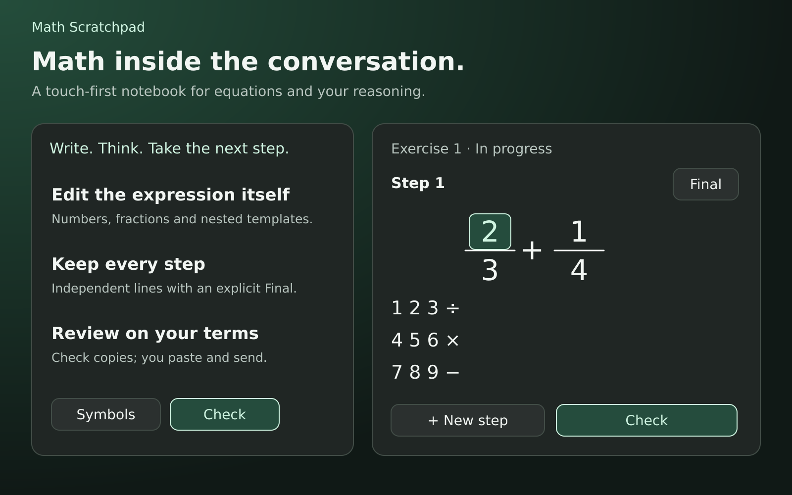

# Math Scratchpad

[](https://github.com/amirhoseinLotfii/math-scratchpad/actions/workflows/ci.yml)
[](LICENSE)

**Write the math. Show your reasoning. Master fractions without answer hints.** A responsive, keyboard-first math notebook with direct structural editing, a 30-question diagnostic, and exact-rational feedback.

[راهنمای فارسی](README.fa.md) · [Architecture](docs/architecture.md) · [Design system](docs/design-system.md) · [Roadmap](ROADMAP.md) · [Contributing](CONTRIBUTING.md)

Project: [amirhoseinLotfii/math-scratchpad](https://github.com/amirhoseinLotfii/math-scratchpad) · [Release updates](https://github.com/amirhoseinLotfii/math-scratchpad/releases)

Write fractions where you see them. Tap a digit to place the caret. Keep your reasoning in ordered steps, then copy the original problem and your work for review in ChatGPT.

Built with **React 19, TypeScript, Redux Toolkit 2 and Vite 8**. This is an open-source editor prototype with source, tests and self-contained builds.

## New in 0.5 — Fraction Mastery & keyboard-first editing

- **30 no-hint diagnostic questions:** Persian question statements, English/LTR controls, and vertically typeset mathematical expressions.
- **One stable notebook:** Navigate with **Previous / Next Problem** while each question retains its own editable steps. No re-creating the UI between questions.
- **Desktop workspace, mobile simplicity:** The math keyboard docks beside the notebook on wide screens and stacks on narrow ones. Hide it for a full-width writing area; preference is saved when storage is available.
- **Semantic navigation:** Left/right traverses items on the main math line (numerator to the next item's numerator, not denominator); up/down changes fraction levels. Use Tab for DOM field navigation and Ctrl/Cmd+Z, Ctrl/Cmd+Shift+Z for history.
- **Keyboard insertion:** Insert numbers, fractions, powers, parentheses and roots with an accessible, arrow-key-driven chooser, Enter or a direct operator shortcut. Delete a selected structure without touching the answer in other fields.
- **Provisional assessment:** Exact rational arithmetic distinguishes the **numerical value**, **required simplified form**, and **equality-chain consistency**. Unsupported or ambiguous notation is marked **unverified**, not silently wrong.
- **Private by default:** Local draft persistence and session JSON exports; no account credentials, user exercise data or analytics are sent to external services.

> The question bank runs locally. Assessment is a learning aid rather than a proof of mathematical reasoning; review flagged steps manually. `Check` still copies a prompt for human/ChatGPT review and never sends on its own.

**Try it locally:** `npm ci && npm run dev` — choose **Menu → Start 30-question diagnostic**. [Read the Persian guide](README.fa.md).

## Feature gallery

Explore the current keyboard, direct fraction editing, steps, notation templates and review workflow in [12 vector feature illustrations](docs/gallery.md). These are explanatory artwork, not captured app screens.



[View all 12 features](docs/gallery.md)

## What makes it useful

- **One formula, directly editable.** Vertical fractions, powers, roots, parentheses and templates are the actual interactive expression.
- **LTR by design.** ASCII digits, explicit direction, isolated math regions, matching visual and logical order—even alongside a Persian problem.
- **A real notebook.** Independent steps, an explicit final-answer marker, 80-edit Undo/Redo and later-step `Needs review` labels after earlier edits.
- **Mobile and desktop controls.** Optional docked/stacked keyboard, compact/full modes, topic-based Symbols, favorites and recently used symbols.
- **Structural navigation.** Arrow keys move across same-level math items, or vertically within fractions. The `Next` key still traverses template fields. Main-line dots insert outside structures.
- **Whole-structure editing.** Select a parent structure, then Copy, Cut, Duplicate, Paste or Delete. This clipboard stays inside the editor.
- **Intentional review.** `Check` copies a complete message with the original problem, every ordered step, review scope and explicitly marked final answer. You paste and send it. `Changed since copy` makes stale snapshots visible.
- **Local drafts and portable sessions.** Best-effort draft restoration, JSON backup/import and migration of the previous v1 session format.

## Try the development build

Requires Node.js **24** and npm.

```sh
npm ci
npm run dev
```

The development server prints its local URL. To validate and build:

```sh
npm test
npm run build
npm run preview
```

`npm run build` performs strict TypeScript checking before generating:

| Output | Purpose |
| --- | --- |
| `dist/index.html` + `dist/assets/` | Standard production build |
| `dist/standalone.html` | Single file with bundled React, Redux, CSS and application code |
| `dist/inline-fragment.html` | Host integration fragment, under 1 MB, with no network dependencies |

The inline fragment runs only in a host that explicitly supports executable HTML. Pasting source code into an ordinary ChatGPT message does **not** install an editor or guarantee a runnable view. No MCP server, model API, account credential or deployment is included.

## A small editing walkthrough

1. Start with `2/3 + 1/4`, or choose **New** and enter a problem as math/LaTeX or Persian text.
2. Tap a numerator or denominator; use the numeric keys or a physical keyboard.
3. Tap **Next** to move between fields. A main-line dot places the insertion point outside a structure.
4. Add an empty **New step** to write your reasoning. Mark **Final** only on your chosen final answer.
5. Press **Check**, paste the copied message into the conversation and send it for review.

`Check` never silently grades work, sends a message, or labels it “sent.” The separate diagnostic Finish action provides only provisional local grading. When browser clipboard access is blocked, a selectable manual-copy message appears.

## Notation coverage and boundaries

The symbol catalog includes arithmetic, algebraic relations, functions, calculus, 2×2/3×3 matrices, probability and statistics **notation**. It is not a computer algebra system. Graph plotting, full computer-algebra equation solving, general symbolic validation, handwriting recognition and automatic Persian-to-formula conversion are not implemented.

The bounded paste importer supports fractions, powers, roots, parentheses, decimal numbers, variables, common functions and relations. Some advanced LaTeX commands must be entered through Symbols instead. Unknown input produces an error; it is not guessed. Use JSON sessions for lossless transfer of all supported structures.

## Quality and privacy

- Automated reducer and React DOM tests cover exact token identity, digit caret placement, main-line insertion, structural editing, navigation, history, copy success/failure and session validation. The 0.5 diagnostic adds parser and numerical-grading regression tests.
- CSS targets widths down to 320 px, 48 px controls, wrapping at top-level operators and contained horizontal scrolling for wide structures.
- Physical Android touch coordinates, host overlay behavior and screen-reader usability still need device testing. DOM tests are not a substitute for those checks.
- No analytics, model requests or third-party API calls. Drafts stay in local browser storage when available. `Check` puts your exercise in the clipboard only when you request it.

See [the QA report](docs/qa.md) for exact evidence and remaining checks.

## Help shape the editor

Useful feedback is concrete: device, width, expression, tap target and the result you expected. Accessibility, LTR/RTL edge cases, parser coverage and mobile editing are especially welcome. See [Contributing](CONTRIBUTING.md).

**Help others learn:** share [Math Scratchpad](https://github.com/amirhoseinLotfii/math-scratchpad) with students, math tutors and accessible-editor enthusiasts. Contributions that improve keyboard accessibility and the fraction diagnostic are especially welcome. If this project helps you, a star makes it easier to find. Use **Watch → Custom → Releases** for updates, or follow the maintainer for future work. No stars, followers or adoption figures are claimed.

## License

MIT. See [LICENSE](LICENSE). React, Redux and the other dependencies retain their respective licenses; bundled distributions include third-party notices.
