# Feature gallery

Twelve vector feature illustrations for the current editor. These explain implemented behavior; they are not captured app screens or pixel-perfect layout evidence. The editable product remains the source of truth. Math notation templates are not a local solver. Check copies text for manual pasting and sending.

SVG text and shapes remain sharp when enlarged. All images are self-contained, with no external scripts, fonts, images or services.

## Math inside the conversation.

A touch-first notebook for equations and your reasoning.

## Fractions in the right direction.

Left-to-right math. Separate numerator and denominator targets.

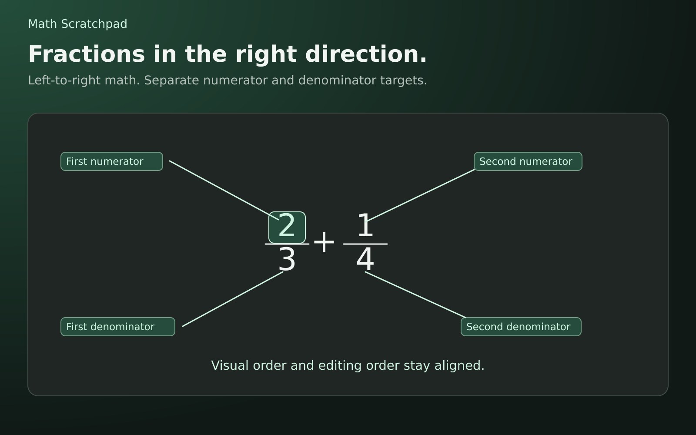

## Place the cursor where you need it.

Edit a digit, or insert on the main line beside a fraction.

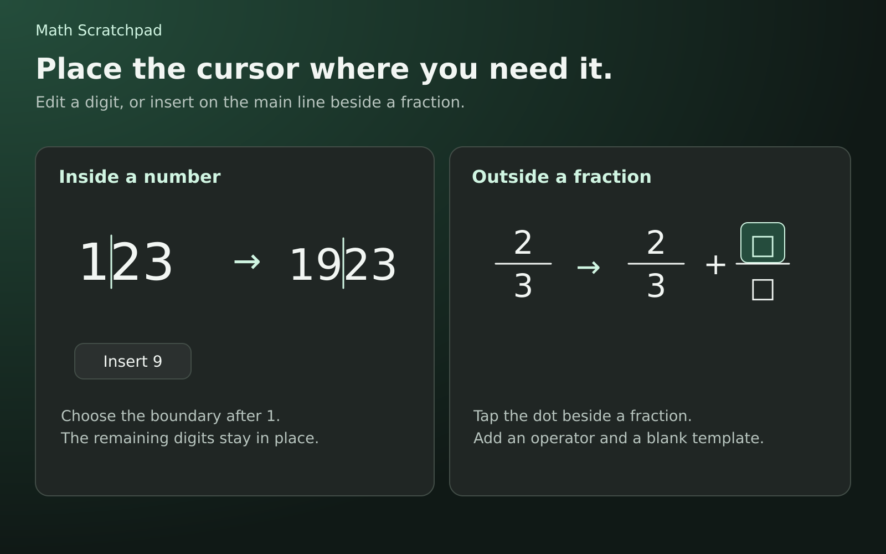

## Start at the top-left.

Ascending numbers and Backspace beside the quick templates.

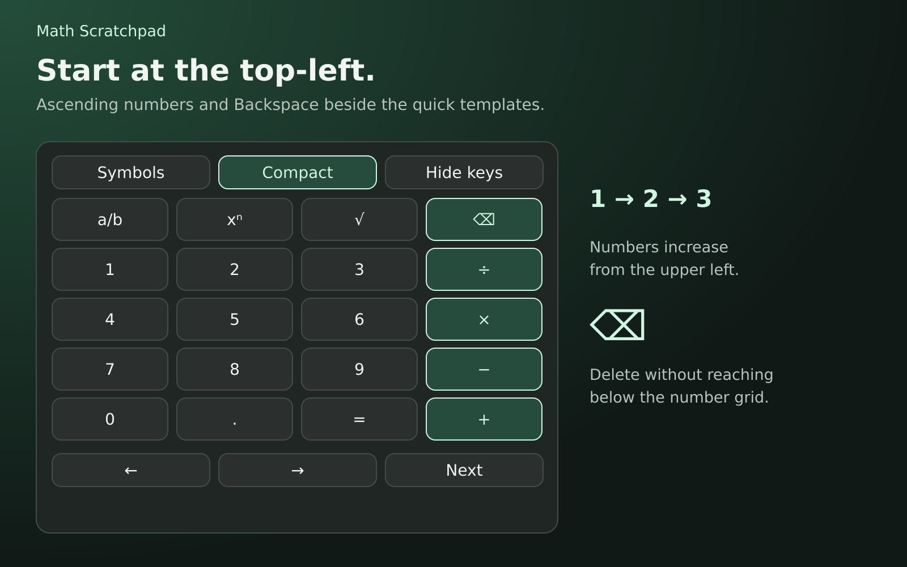

## Keep the whole solution in view.

Revising an earlier line preserves later work and marks it for review.

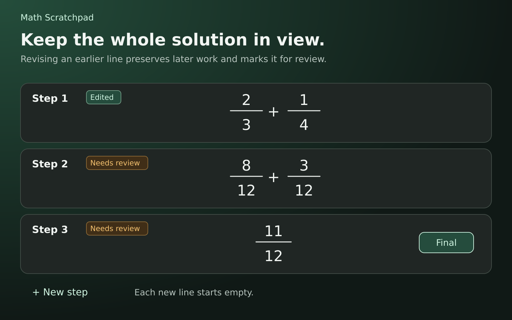

## Find symbols by topic.

Favorites, recent symbols and a preview before insertion.

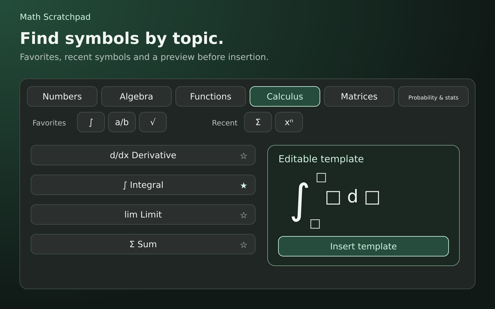

## Fill the fields. Keep moving.

Next walks through template fields and returns to the main line.

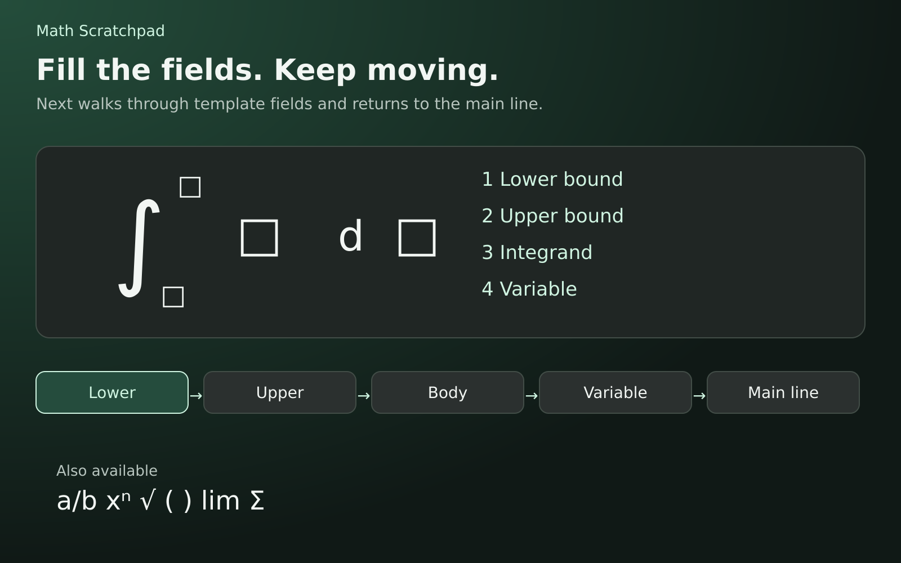

## Go beyond arithmetic.

Editable matrix, probability and statistics notation.

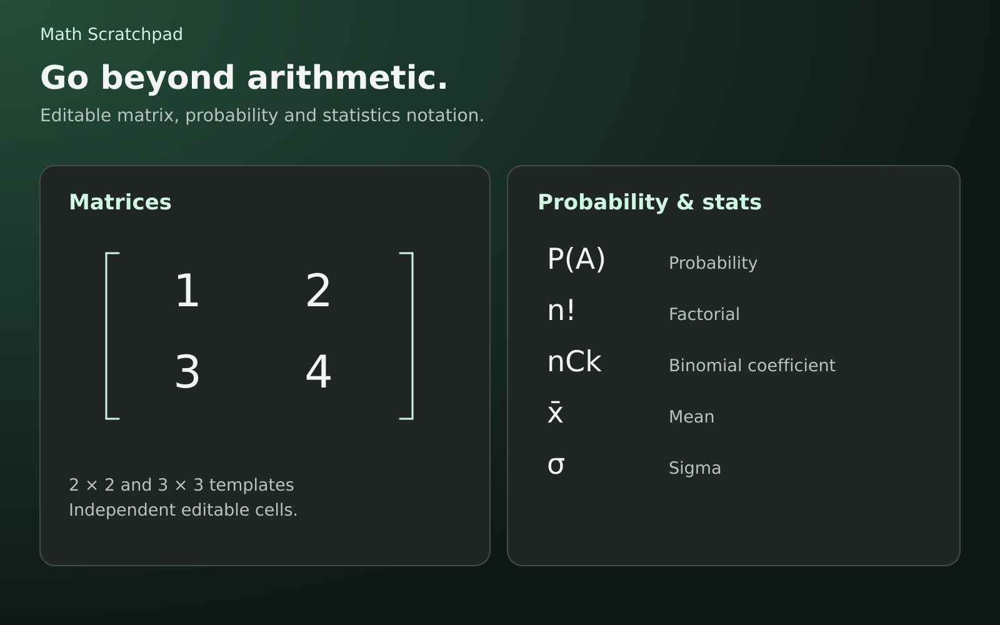

## Select the whole structure.

Copy, cut, duplicate or paste while keeping nested fields together.

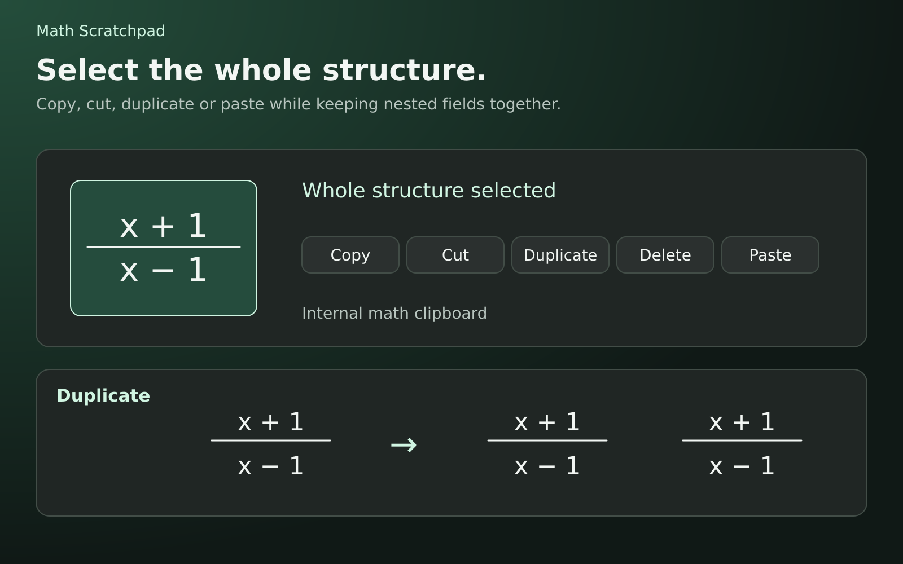

## Try an edit. Keep a way back.

Undo and Redo restore document history, including structured math.

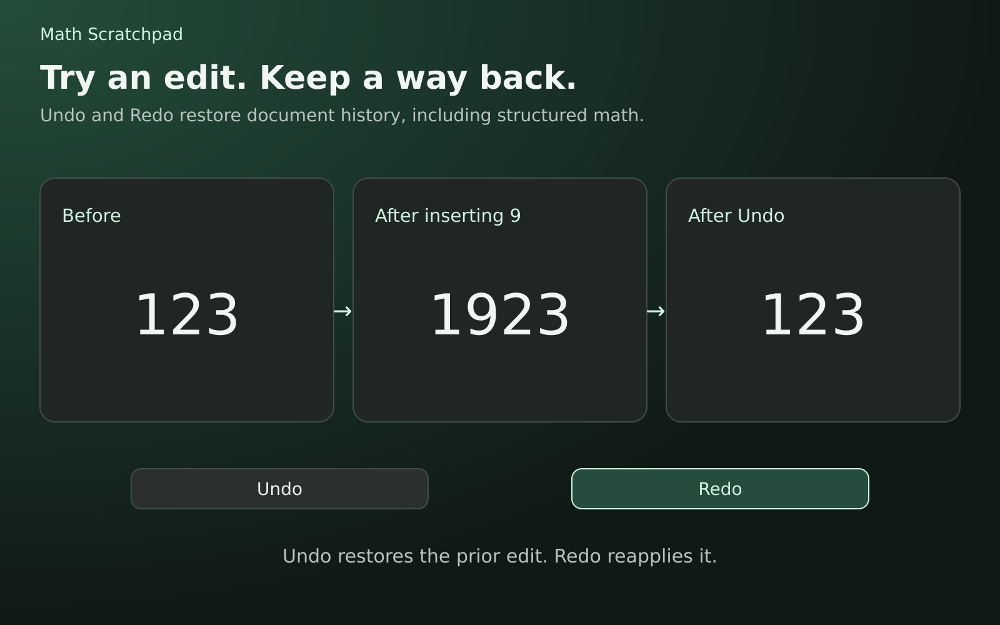

## Start fresh. Pick up your work.

Math / LaTeX input, Persian problem text and portable session backups.

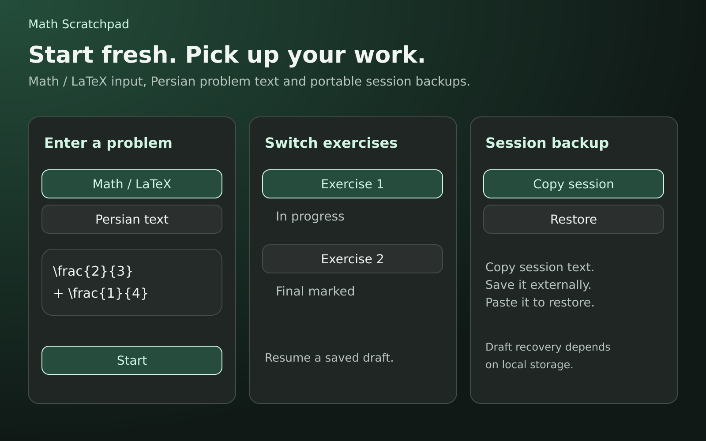

## Your work. Your review request.

Check copies the problem and steps; you paste and send in the chat.

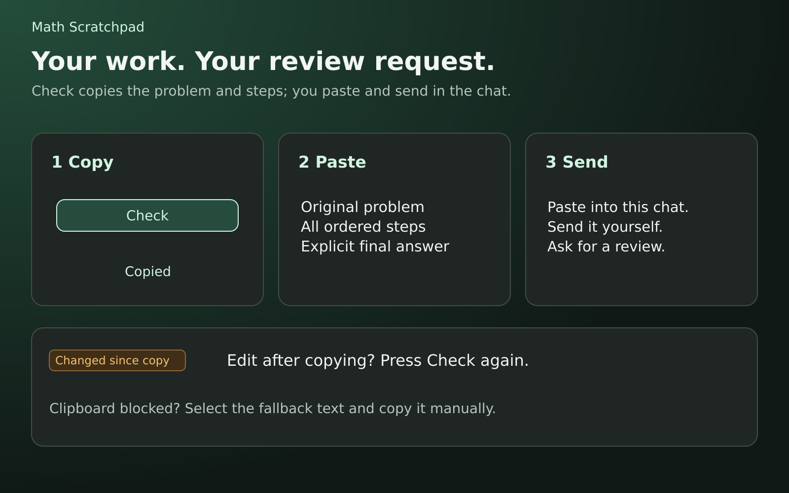
